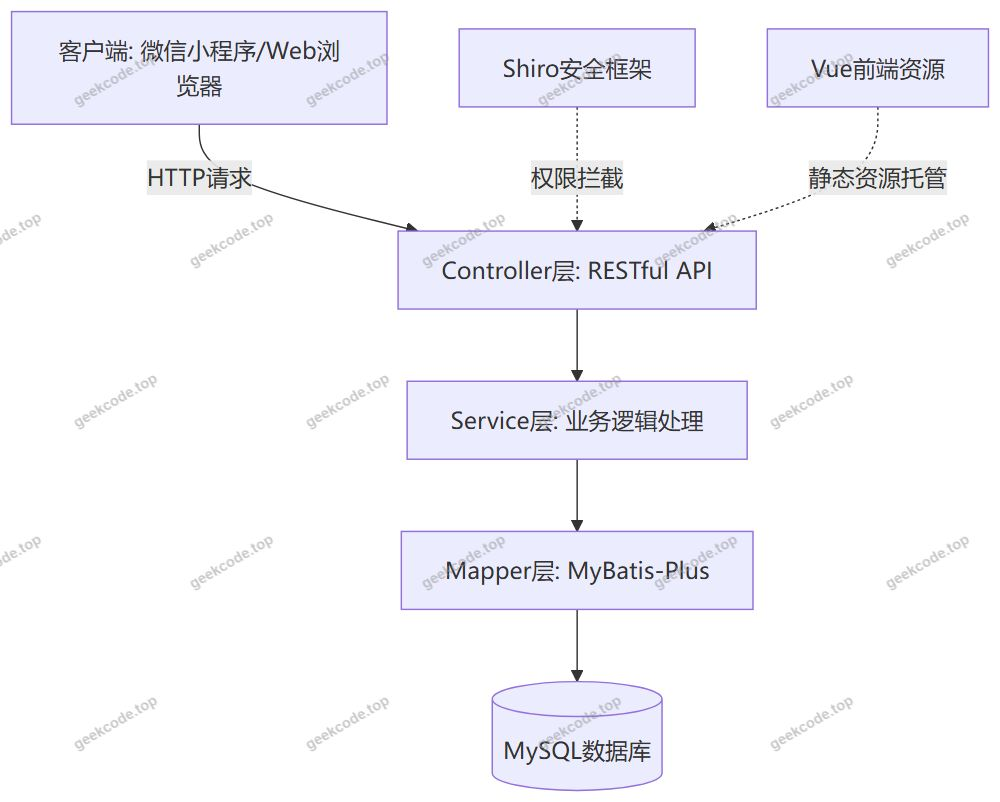
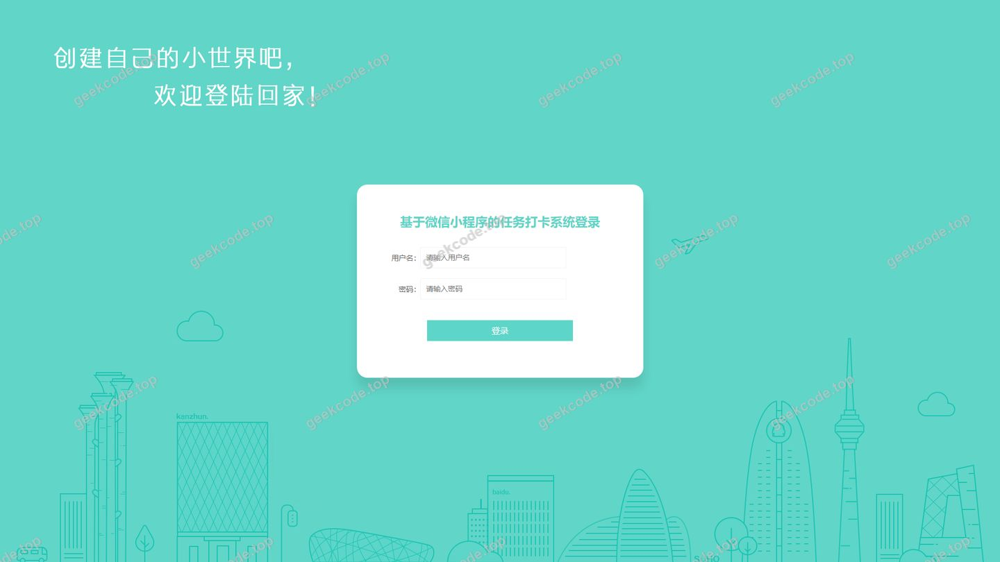
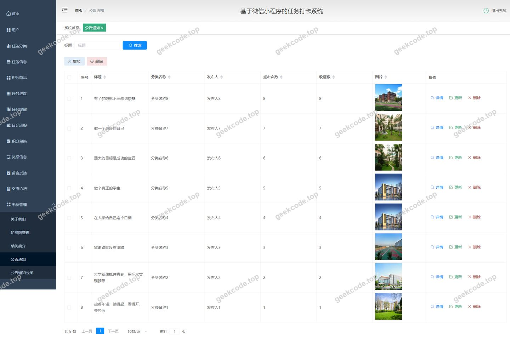
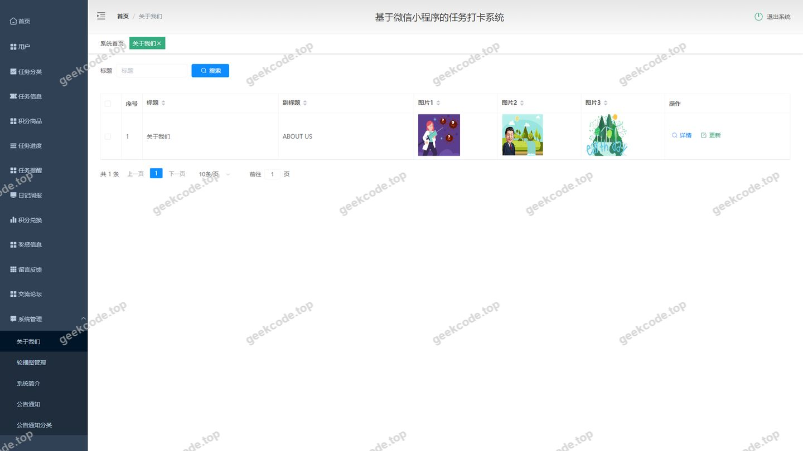
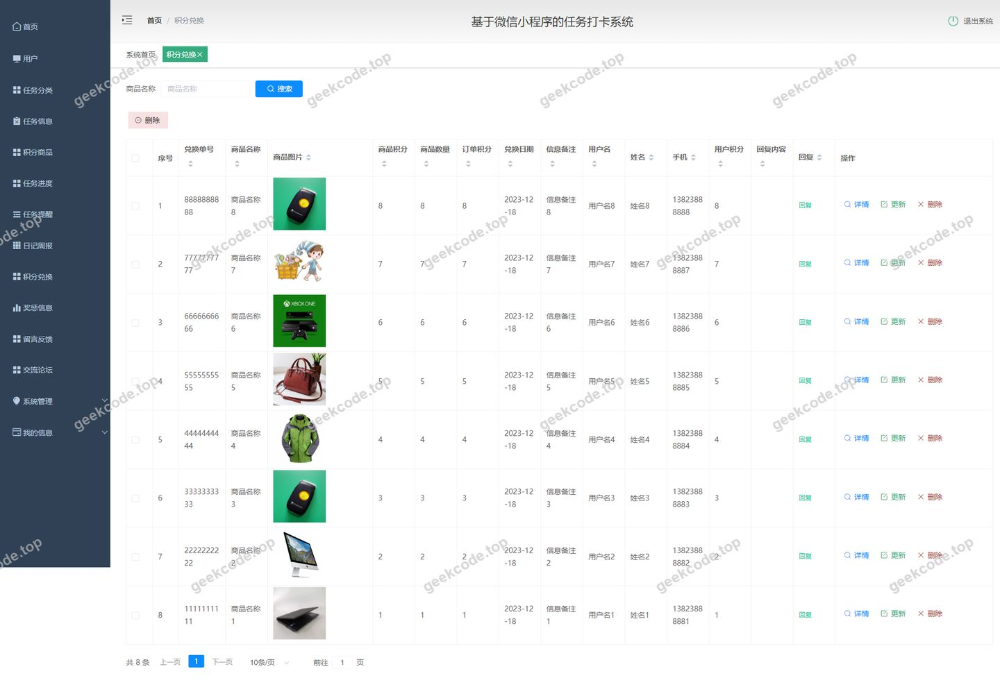
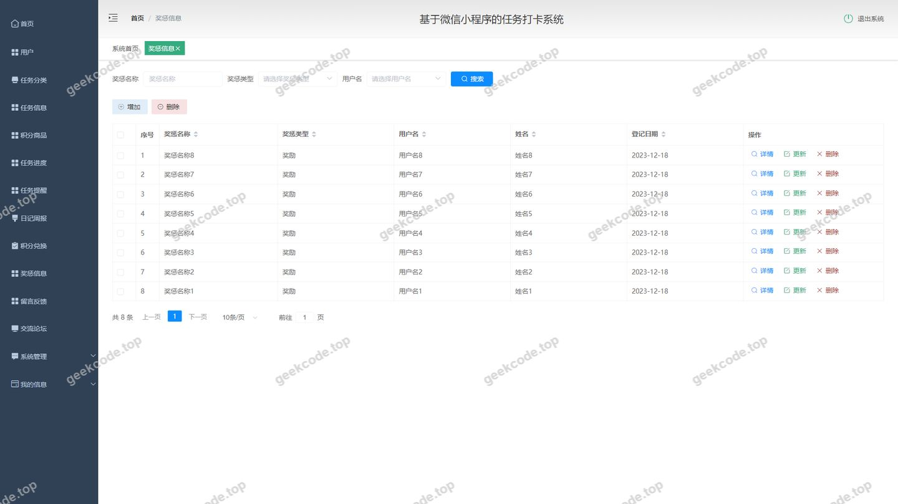
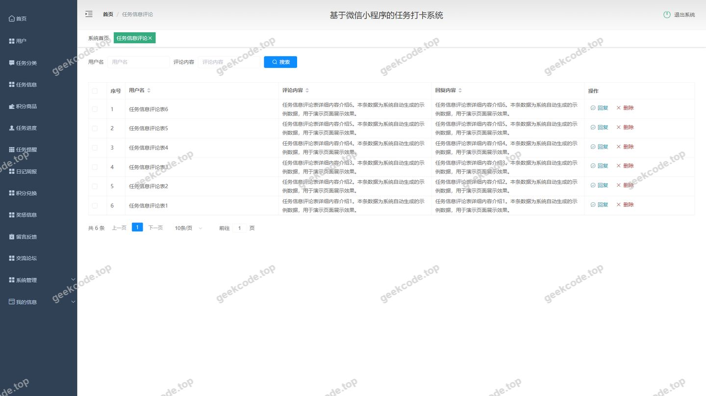
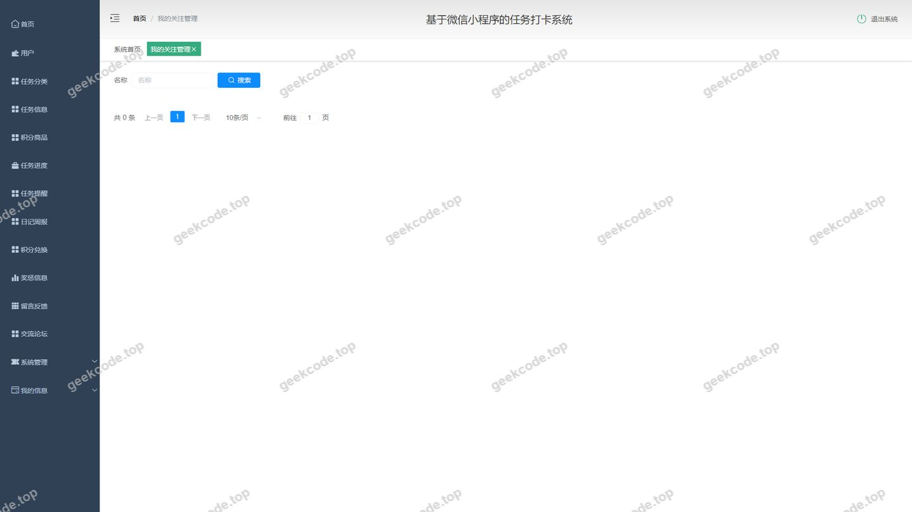
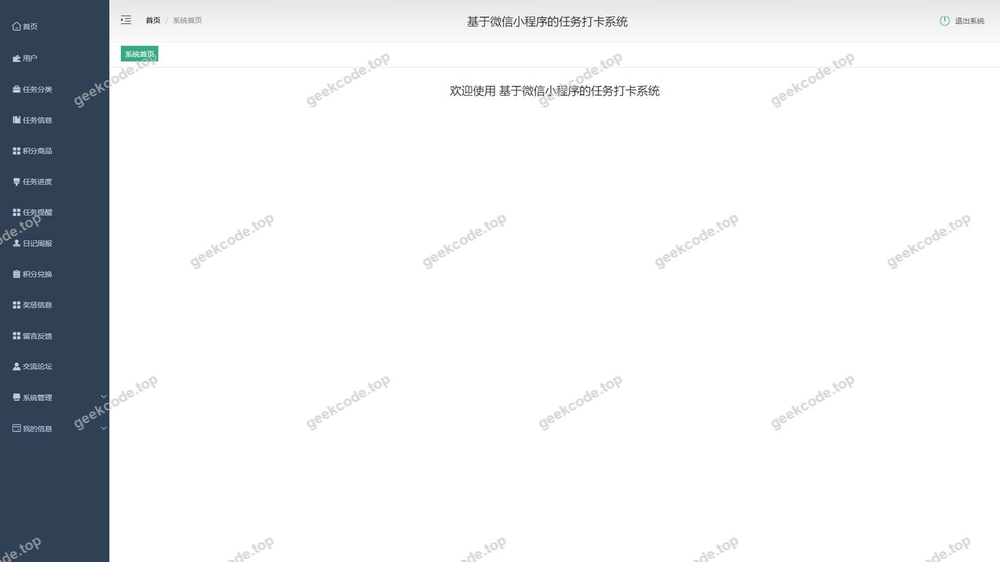

# springboot基于微信小程序的任务打卡系统

> 🎓 **计算机毕业设计 · springboot基于微信小程序的任务打卡系统**
>
> 本仓库只放**项目介绍 + 运行截图**（截图是站点带水印的原图，存在仓库 `images/` 里）。
>
> 👉 **完整可运行源码 / 数据库脚本 / 部署文档：[点我获取](https://geekcode.top/archives/springboot%E5%9F%BA%E4%BA%8E%E5%BE%AE%E4%BF%A1%E5%B0%8F%E7%A8%8B%E5%BA%8F%E7%9A%84%E4%BB%BB%E5%8A%A1%E6%89%93%E5%8D%A1%E7%B3%BB%E7%BB%9F?utm_source=github)**
>
> 💬 咨询微信：**ir9372**　|　🌐 更多项目：[极客代码 geekcode.top](https://geekcode.top/?utm_source=github)
>
> 📌 项目详情页：<https://geekcode.top/archives/springboot%E5%9F%BA%E4%BA%8E%E5%BE%AE%E4%BF%A1%E5%B0%8F%E7%A8%8B%E5%BA%8F%E7%9A%84%E4%BB%BB%E5%8A%A1%E6%89%93%E5%8D%A1%E7%B3%BB%E7%BB%9F?utm_source=github>

<table><td width="230" align="center"> <b>扫码加微信 ir9372</b></td><td valign="middle">📦 源码 = 项目介绍 + 全部运行截图 + 数据库 + 部署文档 👉 点上方任意截图，直接跳到 <b>极客代码 geekcode.top</b> 详情页</td></table>

---

<h1>springboot基于微信小程序的任务打卡系统</h1>
<h2>项目概述</h2>

本项目旨在构建一个基于微信小程序生态的任务打卡管理系统，核心目标是解决个人或团队在任务执行过程中的进度追踪、习惯养成及激励机制问题。系统采用前后端分离架构，后端基于 Spring Boot 框架开发，提供稳定高效的 API 服务；前端通过微信小程序实现用户交互（注：根据提供的路由列表，当前展示的是后台管理界面，小程序端逻辑隐含于业务中）。主要功能涵盖任务信息管理、分类、提醒、进度记录、奖惩机制以及积分商城兑换等。适用人群包括需要自我管理的个人用户、追求高效协作的团队管理者以及教育培训机构。技术架构上，选用 MyBatis-Plus 简化数据持久层操作，Apache Shiro 保障系统安全认证与授权，MySQL 作为数据存储中心，整体设计兼顾了系统的可扩展性与安全性。

<h2>技术架构</h2>
<h3>1. 总体架构</h3>

本项目采用经典的 B/S（Browser/Server）架构模式，具体表现为“Spring Boot 后端 + MySQL 数据库”的集成方案。虽然项目名称提及微信小程序，但根据提供的源码上下文和路由配置，当前文档重点描述其服务端支撑体系。系统分为表现层、业务逻辑层和数据访问层。

<h3>2. 核心技术选型理由</h3>
<ul>
<li><strong>Spring Boot</strong>: 作为核心框架，利用其自动配置和起步依赖特性，快速搭建企业级应用，简化了 XML 配置，提升了开发效率。</li>
<li><strong>MyBatis-Plus</strong>: 在 MyBatis 基础上增强，提供了通用的 CRUD 接口和条件构造器，极大减少了样板代码，适合本项目中大量的实体类（如任务、积分、用户）的数据操作。</li>
<li><strong>Apache Shiro</strong>: 轻量级的安全框架，用于处理身份验证（Authentication）、授权（Authorization）和会话管理。相比 Spring Security，Shiro 配置更简单，更适合中小型项目的权限控制需求。</li>
<li><strong>MySQL</strong>: 关系型数据库，支持事务处理，保证任务状态更新和积分变动等关键业务数据的一致性。</li>
<li><strong>Vue-integrated</strong>: 项目标记为 Vue 集成类型，表明后台管理界面可能采用 Vue.js 构建，并通过 Spring Boot 进行统一打包部署或静态资源映射，实现了前后端的逻辑分离与物理整合。</li>
</ul>
<h3>3. 数据库设计要点</h3>

数据库设计围绕“任务”与“激励”两大核心实体展开。主要包含以下模块表结构：

<ul>
<li><strong>基础信息表</strong>: <code>yonghu</code> (用户), <code>config</code> (系统配置)。</li>
<li><strong>任务管理表</strong>: <code>renwuxinxi</code> (任务信息), <code>renwufenlei</code> (任务分类), <code>renwujindu</code> (任务进度), <code>renwutixing</code> (任务提醒)。</li>
<li><strong>互动与内容表</strong>: <code>news</code> (公告通知), <code>newstype</code> (新闻类型), <code>forum</code> (论坛/讨论区), <code>discussrenwuxinxi</code> (任务评论), <code>aboutus</code> (关于我们)。</li>
<li><strong>激励体系表</strong>: <code>jifenshangpin</code> (积分商品), <code>jifenduihuan</code> (积分兑换记录), <code>jiangchengxinxi</code> (奖惩信息), <code>storeup</code> (收藏/关注), <code>rijizhoubao</code> (日志/周报)。
这种设计确保了从任务创建、执行监控到结果反馈、奖励兑换的全链路数据闭环。</li>
</ul>
<h2>功能模块</h2>

根据后台路由 <code>/news</code>, <code>/aboutus</code>, <code>/jiangchengxinxi</code>, <code>/discussrenwuxinxi</code>, <code>/jifenduihuan</code>, <code>/storeup</code>, <code>/rijizhoubao</code>, <code>/renwujindu</code>, <code>/forum</code>, <code>/jifenshangpin</code>, <code>/systemintro</code>, <code>/renwufenlei</code>, <code>/yonghu</code>, <code>/renwutixing</code>, <code>/messages</code>, <code>/renwuxinxi</code>, <code>/config</code>, <code>/newstype</code> 及截图信息，系统主要功能模块如下：

<h3>1. 后台管理端功能</h3>

后台是管理员维护系统运行、审核内容及查看数据的中心。

<ul>
<li>
<strong>任务管理中心</strong>

</li>
<li>
<strong>任务信息管理 (<code>/renwuxinxi</code>)</strong>: 发布新任务，编辑任务详情（名称、描述、截止时间等），删除无效任务。

</li>
<li>
<strong>任务分类管理 (<code>/renwufenlei</code>)</strong>: 定义任务的类别标签（如学习、工作、健身），便于用户筛选。

</li>
<li>
<strong>任务进度监控 (<code>/renwujindu</code>)</strong>: 查看各任务的完成状态统计，掌握整体执行情况。

</li>
<li>
<strong>任务提醒管理 (<code>/renwutixing</code>)</strong>: 设置和管理任务截止前的提醒策略。

</li>
<li>
<strong>激励与积分体系</strong>

</li>
<li>
<strong>积分商品管理 (<code>/jifenshangpin</code>)</strong>: 上架、下架或修改可供兑换的商品信息。

</li>
<li>
<strong>积分兑换管理 (<code>/jifenduihuan</code>)</strong>: 审核用户的积分兑换申请，处理发货或发放虚拟权益。

</li>
<li>
<strong>奖惩信息管理 (<code>/jiangchengxinxi</code>)</strong>: 录入针对用户表现的奖励或惩罚记录，关联至用户账户。

</li>
<li>
<strong>内容与社区管理</strong>

</li>
<li>
<strong>公告通知管理 (<code>/news</code>, <code>/newstype</code>)</strong>: 发布系统公告，管理新闻分类。

</li>
<li>
<strong>论坛/讨论区管理 (<code>/forum</code>)</strong>: 维护公共讨论板块的内容。

</li>
<li>
<strong>任务评论管理 (<code>/discussrenwuxinxi</code>)</strong>: 审核用户对特定任务的评论，过滤不良信息。

</li>
<li>
<strong>我的关注/收藏管理 (<code>/storeup</code>)</strong>: 查看和管理用户的收藏行为数据（通常用于数据分析或推荐）。

</li>
<li>
<strong>系统与用户管理</strong>

</li>
<li>
<strong>用户管理 (<code>/yonghu</code>)</strong>: 查询注册用户信息，重置密码，禁用违规账号。

</li>
<li>
<strong>消息管理 (<code>/messages</code>)</strong>: 查看站内信或系统通知发送记录。

</li>
<li>
<strong>日志/周报管理 (<code>/rijizhoubao</code>)</strong>: 查看用户提交的日常记录或周期性总结。

</li>
<li>
<strong>系统配置 (<code>/config</code>)</strong>: 修改网站标题、Logo、联系方式等全局参数。

</li>
<li>
<strong>关于我们 (<code>/aboutus</code>, <code>/systemintro</code>)</strong>: 编辑平台介绍文案。

</li>
</ul>
<h3>2. 前台用户端功能（基于小程序逻辑推导）</h3>

<em>注：由于提供的路由主要为后台路径，且明确标注“是否有前台: 否”，此处仅基于业务逻辑简述小程序端应有的核心交互，不作为独立Web前台页面列出。</em>

<ul>
<li><strong>任务打卡</strong>: 用户浏览任务列表，点击签到或提交完成凭证。</li>
<li><strong>积分获取与消费</strong>: 完成任务获得积分，在积分商城兑换商品。</li>
<li><strong>社交互动</strong>: 对任务发表评论，参与论坛讨论。</li>
<li><strong>个人中心</strong>: 查看个人任务进度、收藏列表及奖惩记录。</li>
</ul>
<h2>用户角色与权限</h2>

系统主要涉及两类角色：<strong>超级管理员</strong> 和 <strong>普通用户</strong>。根据 Shiro 框架的特性及后台路由设计，权限划分如下：

<h3>1. 超级管理员 (Admin)</h3>

拥有系统最高权限，可访问所有后台路由模块。

<ul>
<li><strong>权限范围</strong>:</li>
<li><strong>全量CRUD</strong>: 对所有业务实体（任务、用户、积分商品、公告等）进行增删改查。</li>
<li><strong>审核权</strong>: 审核积分兑换申请、任务评论内容。</li>
<li><strong>配置权</strong>: 修改系统全局配置、用户权限分配（若存在子管理员概念）。</li>
<li><strong>数据可视性</strong>: 查看所有用户的打卡记录、积分余额、奖惩历史。</li>
<li><strong>可访问模块</strong>: 登录页、首页仪表盘、任务管理全套、积分管理全套、内容管理全套、用户管理、系统设置。</li>
</ul>
<h3>2. 普通用户 (User)</h3>

主要通过微信小程序前端接入，无直接后台路由访问权限（除非具备特殊角色标识，但根据现有路由列表，后台入口主要面向 Admin）。

<ul>
<li><strong>权限范围</strong>:</li>
<li><strong>任务操作</strong>: 查看公开任务，进行打卡，上传进度证明。</li>
<li><strong>积分操作</strong>: 查看可用积分，发起兑换请求。</li>
<li><strong>内容贡献</strong>: 发布任务评论，撰写日志/周报。</li>
<li><strong>个人数据</strong>: 仅能查看和操作属于自己的数据（如自己的收藏、自己的进度）。</li>
<li><strong>限制</strong>: 无法进入 <code>/admin</code> 相关路由，无法修改他人数据或系统配置。</li>
</ul>
<h2>项目特色与创新点</h2>
<ol>
<li>
<strong>闭环式激励管理体系</strong>:
   不同于简单的待办事项清单，本项目构建了完整的“任务执行 -&gt; 进度记录 -&gt; 奖惩判定 -&gt; 积分累积 -&gt; 实物/虚拟兑换”的业务闭环。通过 <code>jifenduihuan</code> (积分兑换) 和 <code>jiangchengxinxi</code> (奖惩信息) 模块的结合，有效提升了用户的粘性和任务完成率。

</li>
<li>
<strong>多维度的内容互动</strong>:
   集成了 <code>forum</code> (论坛)、<code>discussrenwuxinxi</code> (任务评论) 和 <code>news</code> (公告)，不仅支持单向的任务下发，还鼓励用户间的横向交流与经验分享，增强了社区的活跃度。

</li>
<li>
<strong>灵活的数据追踪</strong>:
   引入 <code>rijizhoubao</code> (日志/周报) 和 <code>renwujindu</code> (任务进度) 双维度追踪机制。既支持细粒度的每日打卡记录，也支持宏观周期的总结汇报，适应不同场景下的自我管理需求。

</li>
<li>
<strong>稳健的安全架构</strong>:
   采用 Apache Shiro 进行权限控制，结合 Spring Boot 的稳定性，确保了用户数据和系统配置的安全性。MyBatis-Plus 的使用提高了数据操作的效率和安全性，防止 SQL 注入风险。

</li>
</ol>
<h2>部署环境</h2>

为了确保项目正常运行，需准备以下软件环境：

<ol>
<li><strong>Java 开发环境</strong>:</li>
</ol>
<ul>
<li>JDK 版本: JDK 1.8 或 JDK 11 (推荐，兼容大多数 Spring Boot 2.x 版本)。</li>
<li>Maven: 3.6+ 用于项目依赖管理和打包。</li>
</ul>
<ol start="2">
<li><strong>数据库环境</strong>:</li>
</ol>
<ul>
<li>MySQL: 5.7 或 8.0 版本。需创建对应的数据库实例并导入初始化 SQL 脚本。</li>
</ul>
<ol start="3">
<li><strong>服务器中间件</strong>:</li>
</ol>
<ul>
<li>Tomcat: 内置于 Spring Boot Starter Web 中，无需单独安装外部 Tomcat，直接通过 <code>java -jar</code> 启动即可。</li>
</ul>
<ol start="4">
<li><strong>前端/小程序开发环境</strong>:</li>
</ol>
<ul>
<li>Node.js: 12.x 或更高版本，用于编译 Vue 前端资源（如果前端代码未预编译）。</li>
<li>微信开发者工具: 最新稳定版，用于调试和发布微信小程序前端部分。</li>
</ul>
<ol start="5">
<li><strong>操作系统</strong>:</li>
</ol>
<ul>
<li>Windows 10/11, macOS, 或 Linux (CentOS/Ubuntu) 均可。建议生产环境使用 Linux。</li>
</ul>
<h2>五、技术特性</h2>
<ul>
<li>前后端集成部署，前端资源打包至后端 static 目录</li>
<li>使用 MyBatis-Plus 简化数据访问层开发</li>
<li>集成 Shiro 权限框架实现角色权限控制</li>
</ul>
<h2>六、功能模块截图</h2>
<h3>后台管理端</h3>
<h4>后台-登录页</h4>

<h4>后台-公告通知</h4>

<h4>后台-关于我们</h4>

<h4>后台-积分兑换</h4>

<h4>后台-奖惩信息</h4>

<h4>后台-任务信息评论</h4>

<h4>后台-我的关注管理</h4>

<h4>后台首页</h4>

---

## 获取完整源码

| 项目 | 说明 |
| --- | --- |
| 项目名 | springboot基于微信小程序的任务打卡系统 |
| 运行截图 | 本文 9 张（站点带水印原图，仓库 `images/` 目录） |
| 完整源码 | [https://geekcode.top/archives/springboot%E5%9F%BA%E4%BA%8E%E5%BE%AE%E4%BF%A1%E5%B0%8F%E7%A8%8B%E5%BA%8F%E7%9A%84%E4%BB%BB%E5%8A%A1%E6%89%93%E5%8D%A1%E7%B3%BB%E7%BB%9F?utm_source=github](https://geekcode.top/archives/springboot%E5%9F%BA%E4%BA%8E%E5%BE%AE%E4%BF%A1%E5%B0%8F%E7%A8%8B%E5%BA%8F%E7%9A%84%E4%BB%BB%E5%8A%A1%E6%89%93%E5%8D%A1%E7%B3%BB%E7%BB%9F?utm_source=github) |
| 咨询微信 | **ir9372**（备注：jingpin-yuanma） |
| 更多项目 | [极客代码 geekcode.top](https://geekcode.top/?utm_source=github) |

> 需要源码、部署、改配置、跑不起来等问题，加微信 ir9372 沟通，说明项目名即可。
